# Transmission et reception de video en BPSK avec GNU Radio et USRP B210
Chaîne de communication numérique complète (émission **et** réception) pour transférer un fichier vidéo MP4 par voie radio, réalisée avec **GNU Radio Companion** et une radio logicielle **USRP B210**


<!-- Ajoute ici une capture d'écran du flowgraph et/ou une courte vidéo de démonstration -->
<!--  -->

## Sommaire

- [Principe](#principe)
- [Architecture](#architecture)
- [Paramètres principaux](#paramètres-principaux)
- [Prérequis](#prérequis)
- [Utilisation](#utilisation)
- [Résultats](#résultats)
- [Limites et pistes d'amélioration](#limites-et-pistes-damélioration)
- [Réglementation](#réglementation)
- [Crédits](#crédits)
- [Licence](#licence)

## Principe

Le fichier vidéo est lu octet par octet, découpé en paquets, protégé par un CRC32, modulé en **BPSK différentielle** puis transmis par le B210. Côté récepteur, le signal est filtré, resynchronisé (horloge symbole et phase porteuse), démodulé, les paquets sont retrouvés grâce à un code d'accès, vérifiés par CRC puis réécrits dans un fichier MP4.

Les deux chaînes (TX et RX) sont réunies dans le même flowgraph : antenne `TX/RX` en émission, antenne `RX2` en réception.

## Architecture

```mermaid
flowchart LR
    subgraph TX[Émission]
        A[Fichier MP4] --> B[Découpage en paquets<br/>1024 octets]
        B --> C[CRC32]
        C --> D[Protocol formatter<br/>en-tête + code d'accès]
        C --> E
        D --> E[Tagged stream mux<br/>préambule / en-tête / payload / postambule]
        E --> F[Modulateur BPSK<br/>différentiel, RRC 0.35, 4 sps]
        F --> G[Gain 0.5]
        G --> H[USRP B210 sink<br/>2.462 GHz]
    end
    subgraph RX[Réception]
        I[USRP B210 source<br/>2.462 GHz] --> J[Filtre RRC]
        J --> K[Symbol sync<br/>ML TED, MMSE 8 taps]
        K --> L[Boucle de Costas]
        L --> M[Constellation decoder]
        M --> N[Décodeur différentiel]
        N --> O[Correlate access code]
        O --> P[Repack bits 1 → 8]
        P --> Q[CRC32 check]
        Q --> R[Fichier MP4 reçu]
    end
    H -. liaison radio .-> I
```



### Structure d'une trame

```
| Préambule      | En-tête (code d'accès + longueur) | Payload + CRC32 | Postambule     |
| 2000 octets    | défaut GNU Radio                  | 1024 + 4 octets | 2000 octets    |
| (0xC0 0xAF)*   |                                   |                 | (0xC0 0xAF)*   |
```

## Paramètres principaux

| Paramètre | Valeur |
|---|---|
| Fréquence porteuse | 2.462 GHz |
| Fréquence d'échantillonnage | 1 Msps |
| Échantillons par symbole (sps) | 4 |
| Débit symbole | 250 kBaud |
| Modulation | BPSK différentielle |
| Filtre de mise en forme | RRC, roll-off 0.35 |
| Taille du payload | 1024 octets (+ CRC32) |
| Préambule / postambule | 2000 octets chacun |
| Gain TX | normalisé, réglable de 0.3 à 1.0 (défaut 0.5) |
| Gain RX | réglable de 12.5 à 49.6 dB (défaut 49.6) |
| Récupération d'horloge | `symbol_sync`, TED ML, bande de boucle 0.045 |
| Récupération de phase | boucle de Costas, ordre 2 |
| Matériel | USRP B210 |

## Prérequis

- GNU Radio 3.10.x (fichier créé avec GRC 3.10.12.0)
- Pilote UHD et un USRP B210 correctement détecté (`uhd_find_devices`)
- Une vidéo de test au format MP4

## Utilisation

1. Clone le dépôt :
   ```bash
   git clone https://github.com/Yameogo2004/Transmission_et_reception_de_video_en_BPSK.git
   cd Transmission_et_reception_de_video_en_BPSK
   ```
2. Place ta vidéo de test dans `input/` et nomme-la `test_video.mp4` (ou modifie le chemin dans le bloc **File Source**).
3. Ouvre `flowgraph/bpsk_video_transmitter.grc` dans GNU Radio Companion.
4. Dans les blocs **UHD: USRP Sink** et **UHD: USRP Source**, remplace le numéro de série (`dev_addr`) par celui de ton B210, ou laisse le champ vide.
5. Vérifie que le bloc **File Sink** écrit bien dans `output/received_video.mp4`.
6. Lance le flowgraph. Règle le gain TX avec le curseur et le gain RX avec la liste déroulante.
7. Une fois la transmission terminée, ouvre `output/received_video.mp4` dans un lecteur vidéo.

> Les dossiers `input/` et `output/` sont volontairement vides dans le dépôt : les fichiers vidéo sont ignorés par Git.

## Résultats

Vidéo testée : 3s, 933ko
Usage d'un seul sdr avec un angle de 120 degres entre les antennes

La vidéo est reçue et lisible avec le flowgraph.

## Limites et pistes d'amélioration

- **Pas de retransmission** : un paquet dont le CRC est faux est simplement rejeté, donc le fichier reçu peut contenir des trous. Un mécanisme ARQ (accusé de réception, retransmission) ou un codage correcteur d'erreurs (FEC) améliorerait la fiabilité.
- **Modulation simple** : le BPSK est robuste mais peu efficace spectralement. QPSK ou 16-QAM permettraient de monter en débit si le rapport signal sur bruit le permet.
- **Lecture d'un fichier complet** : pas de streaming en temps réel, la vidéo est transmise puis lue après réception.
- **Fermeture forcee de gnu radio** : 

## Réglementation

La fréquence utilisée (2.462 GHz) se situe dans la bande ISM 2.4 GHz, partagée avec le Wi-Fi. Effectue les tests à faible puissance, sur de courtes distances, et respecte la réglementation en vigueur dans ton pays (au Maroc, ANRT).

## Crédits

Ce projet est adapté du dépôt open-source de **Suman Das** (M.Tech, IIT Bhubaneswar) :

- Dépôt source : [sumandas-collab/Wireless-Video-Transmission](https://github.com/sumandas-collab/Wireless-Video-Transmission)

### Ce qui provient du projet original

- La structure générale de la chaîne TX/RX (File Source → CRC32 → BPSK différentiel → USRP Sink / USRP Source → RRC → Symbol Sync → Costas → CRC check → File Sink)
- L'utilisation de la modulation BPSK différentielle avec filtre RRC
- Le principe de vérification des paquets par CRC32

### Ce que j'ai modifié ou ajouté

- Changement de la fréquence porteuse : **905.2 MHz → 2.462 GHz** (bande ISM 2.4 GHz)
- Augmentation de la taille des paquets : **64 octets → 1024 octets** (+ CRC32)
- Ajout d'une structure de trame explicite (préambule / en-tête / payload / postambule)
- Ajout du **protocole de framing** (`Protocol Formatter` + `Tagged Stream Mux`)
- Réglage des paramètres de synchronisation (TED ML, bande de boucle 0.045, MMSE 8 taps)
- Ajout des contrôles de gain TX/RX dans le flowgraph
- Rédaction de la documentation (README, schémas, limites, réglementation)

### Blocs standard utilisés

- `gr-digital`, `gr-uhd`, `gr-pdu` (GNU Radio 3.10)
  
## Licence

Ce projet est distribué sous licence MIT. Voir le fichier [LICENSE](LICENSE).

## Auteur

**YAMEOGO Ariel Barthelemy Wendtoin** : élève-ingénieur Réseaux et Télécommunications, ENSA Tétouan  
GitHub : [@Yameogo2004](https://github.com/Yameogo2004)
